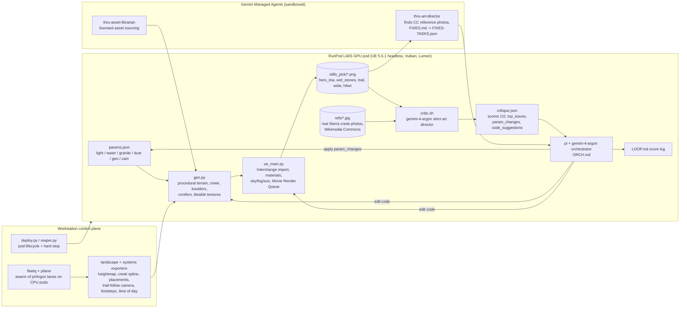
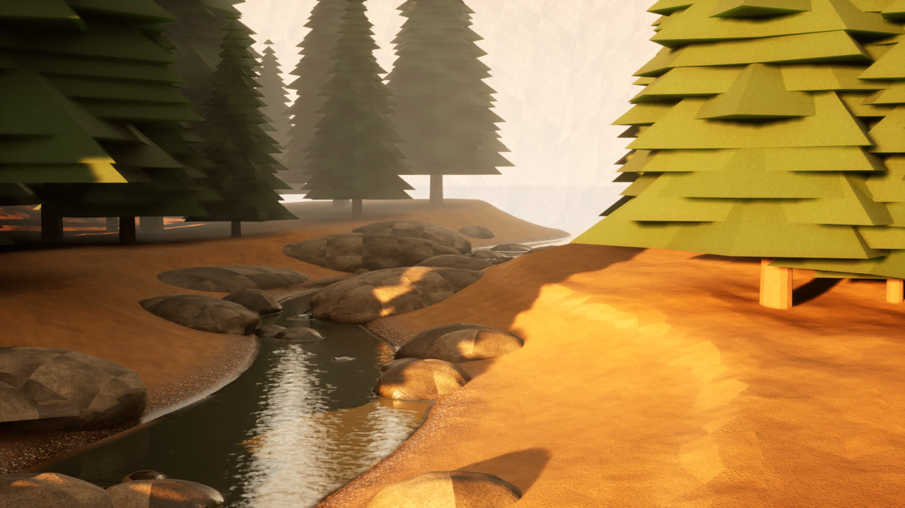
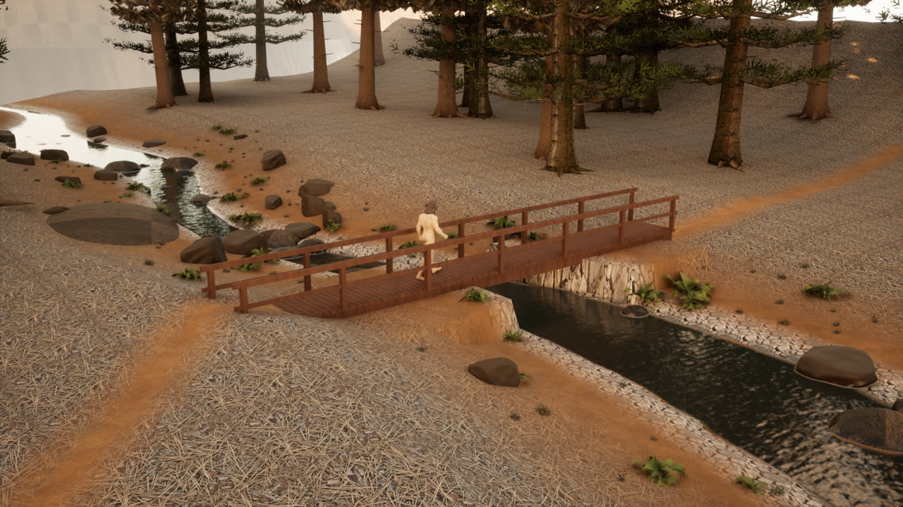
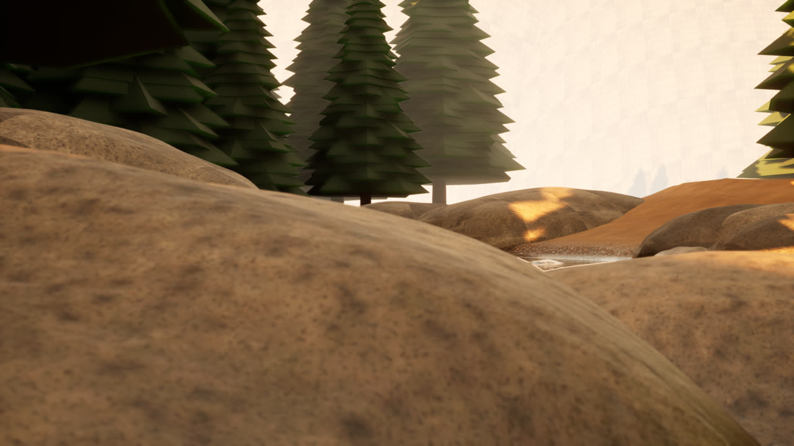
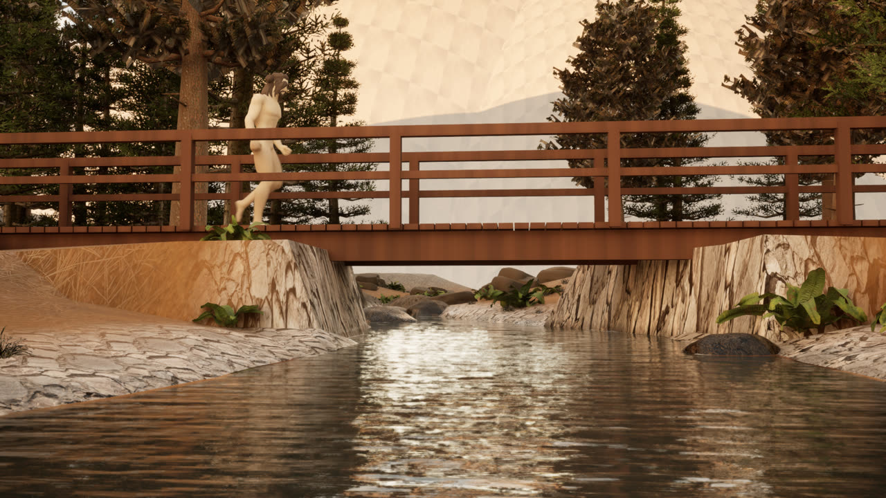
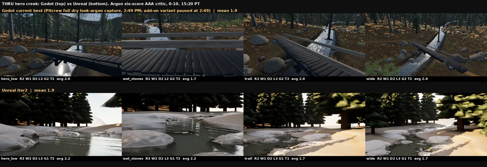

# THRU · Argon render loop

**Gemini 4 Argon SF hackathon (Cerebral Valley), Problem Statement Two: "More Dimensions"**

This is an autonomous **render → watch → critique → fix** loop. It builds a photoreal Pacific Crest Trail creek scene in **Unreal Engine 5.6** on cloud GPUs. After each render, **gemini-4-argon** looks at the Unreal stills next to **real photos of Sierra Nevada creeks**, scores every shot, and returns a list of concrete fixes. The orchestrator (gemini-4-argon driving the `pi` coding agent on the GPU pod) applies those fixes to the scene parameters and code, renders again, and scores the new render. **Gemini Managed Agents** (an art director, an asset librarian, and a license auditor) do research inside sandboxes: they find licensed reference photos and turn the critique into UE5 task lists.

**Who it's for:** indie game developers and world builders who want a scene to look like a real place without an art director standing over every iteration. You give the loop a goal and some real photos. It renders, checks itself against the photos, fixes what's wrong, and runs again.

> Everything in this repo was built during the hackathon on **Oct 25 2026, 10:30 AM PT onward**. See [Built during the hackathon vs pre-existing](#built-during-the-hackathon-vs-pre-existing).

## Architecture



## Results (real numbers, gemini-4-argon critic, 0–10, 10 = indistinguishable from a photo)

The orchestrator's own loop log ([`pipeline/runs/LOOP.md`](pipeline/runs/LOOP.md)):

| iter | time PT | overall | hero_low | wet_stones | trail | wide | what the loop changed |
|---|---|---|---|---|---|---|---|
| iter0 | 14:21 | (broken: faces culled, exposure clamp) | | | | | fixed grid winding, removed exposure clamp |
| iter1 | 14:24 | **2.0** | 1.5 | 2.5 | 2.0 | 2.0 | baseline: first real UE5 render |
| iter2 | 14:40 | **3.1** | 3.5 | 4.0 | 2.5 | 2.5 | smooth GLB normals, triplanar granite, clear hero_low camera, cobble clusters, dome repositioned |

Next pass, with a denser route, the hiker on the bridge path, and pack trees/ferns/grass ([`docs/progression/LOG.md`](docs/progression/LOG.md), [`pipeline/runs/iter2-dense/critique.json`](pipeline/runs/iter2-dense/critique.json)): **overall 2.6** (hero_low 2.5, wet_stones 2.5, trail 3.0, wide 3.0, hiker 2.0). It scored lower than the 14:40 pass because adding the hiker and the bridge brought in new problems for the critic to flag: untextured assets and UV stretching.

Independent six-axis AAA scoring of Godot vs Unreal on the same hero creek ([`docs/compare/SCORES.md`](docs/compare/SCORES.md)): both builds averaged **1.9/10**. Unreal scored higher on reflection (2.5 vs 1.8), wetness (1.5 vs 1.0) and light (3.0 vs 2.8), and lower on geometry (1.0 vs 2.0). That's an honest baseline: the loop runs and makes real changes, but the scene is still far from photoreal.

A live demo run of `demo/run_loop.sh` (fallback mode, Oct 25 at 15:38 PT) re-scored iter1 at **2.0** and the stored iter2 render at **2.4** (+0.4, fix verified) in 26 s total wall time.

| iter1 (first real render) | iter2-dense (15:05 PT, dense route + hiker) |
|---|---|
|  |  |
|  |  |

Godot (top) vs Unreal (bottom): 

## Gemini Managed Agents

[`managed-agents/SHOWCASE.md`](managed-agents/SHOWCASE.md) has the full write-up. Three named agents persist by ID. Each one is defined once in `setup_agents.py`, has its own system instruction and a mounted `SKILL.md`, and runs on base agent `antigravity-preview-09-2026` with model `gemini-3.8-flash`:
- `thru-art-director` compares the real UE stills against CC-licensed Sierra photos it finds itself and writes [`FIXES.md`](managed-agents/outputs/art-director/FIXES.md). On its second turn it reuses the same sandbox (`environment_id`) and turns that file into a machine-readable UE5 task list, [`FIXES-TASKS.json`](managed-agents/outputs/art-director/FIXES-TASKS.json). `ma_critic_hook.py` chains new renders into that persistent sandbox.
- `thru-asset-librarian` made 18 parallel section-by-section research jobs plus 1 gap analysis, and produced [`COVERAGE.md`](managed-agents/outputs/asset-librarian/COVERAGE.md).
- `thru-license-auditor` writes [`LICENSE-AUDIT.md`](managed-agents/outputs/license-auditor/LICENSE-AUDIT.md) and `ATTRIBUTION.txt`.

**Proof of the Managed Agents loop:** [`LOOP-SUMMARY.md`](managed-agents/LOOP-SUMMARY.md) (before/after scores for 2 critique iterations in one persistent environment) and [`RUNS.jsonl`](managed-agents/RUNS.jsonl) (raw log of all 24 interactions, `gemini-3.8-flash`).

As of 15:52 PT: 23 interactions, all completed, across 21 sandboxes and about 56.6M tokens.

## Live demo (judges)

```bash
export GEMINI_API_KEY=...        # read from env only, never written anywhere
bash demo/run_loop.sh            # about 30-90 s
```
One full cycle using real inputs: real UE5 stills plus real Sierra creek photos go to gemini-4-argon. The script prints the scores and top issues, applies the parameter fix (and prints the `params.patch`), then **re-critiques** the re-rendered result and prints the score delta. To use a running UE pod instead of the saved renders, set `UE_POD=root@<host> UE_POD_PORT=<port>`. In that mode the script pulls the pod's latest stills, critiques them, pushes the patched `params.json`, and starts the next real Unreal render. Details are in [`demo/README.md`](demo/README.md).

## Repo map

| path | what |
|---|---|
| `pipeline/src/` | The loop on the pod: `gen.py` (numpy procedural geometry and textures), `ue_main.py` (UE5 Python: materials, lighting, MRQ render), `iterate.sh`, `critic.sh` (Argon critic), `flashlog.sh` (Flash triages UE logs), `ORCH.md` (orchestrator prompt), `run_pi.sh`, `params.json` |
| `pipeline/` | `deploy.py` (RunPod pod deploy; keys read from local env files and never included here), `reaper.py` (hard-stop terminator), `pull*.sh` (UE 5.6.1 container pull), `bootstrap.sh`, `CAMERAS.json`, `AAA-STANDARD.md`, `compare-latest.sh` |
| `pipeline/refs/` | 5 real Sierra creek photos from Wikimedia Commons (sources in `SOURCES.md`) |
| `pipeline/runs/` | `params.json` and `critique.json` for each iteration, plus `LOOP.md` |
| `landscape/` | UE exporters and loaders: heightmap, creek spline and bridge, placements and cameras (raw heightmaps and GLBs left out) |
| `systems/` | THRU gameplay systems ported to UE Python: trail-follow camera/locomotion, footstep surfaces, time of day, audio ambience, with specs and keyframe data |
| `route/` | Hero route and path JSON that drives the walk |
| `managed-agents/` | Gemini Managed Agents: `setup_agents.py`, `AGENTS.json`, `run_*.py`, `ma_critic_hook.py`, `SHOWCASE.md`, `outputs/` (FIXES, task list, coverage, license audit) |
| `swarm/` | Swarm tooling: `pilane/` (pi + Argon lanes on CPU pods), `fleetq/` (GPU/CPU job queue and fleet monitor), `prompts/` (lane prompts and launchers) |
| `demo/` | `run_loop.sh` and `critic_fix.py`, plus saved real UE renders `renders/iter1`, `renders/iter2` |
| `docs/` | Progression stills, Unreal journal, switch log, Godot-vs-Unreal scoring |

## Built during the hackathon vs pre-existing

**Pre-existing (not in this repo):** the THRU game itself (private repo, Godot 4), its Godot scenes, asset library, audio stems, and purchased third-party asset packs. Some of the code here *points to* local pack folders by path (for example `ue_main.py` globbing `packs/*`). **No pack files, meshes or textures are included.**

**Built today, Oct 25 2026, 10:30 AM PT onward (this repo):**
- The Unreal Engine 5.6 headless pipeline on RunPod (container pull, Vulkan bring-up, procedural `gen.py`, `ue_main.py` materials, lighting and MRQ rendering)
- The Argon critic and the autonomous fix loop (`critic.sh`, `iterate.sh`, `ORCH.md`, pi + gemini-4-argon), with scoring against real photos
- Orchestration: pod deploy and reaper, fleetq, pilane swarm, lane prompts and launchers
- The port of systems from Godot data to UE Python (trail follow, footsteps, time of day, audio ambience) and the landscape/placement exporters
- Gemini Managed Agents (art director, asset librarian, license auditor)
- The live demo (`demo/`)

The full timeline is in [`docs/UNREAL-JOURNAL.md`](docs/UNREAL-JOURNAL.md) (13:29 to 15:31 PT).

## How to run the full loop

1. Deploy a GPU pod with `pipeline/deploy.py` (needs your own RunPod and Gemini keys in local env files). Pull UE 5.6.1 with `pipeline/pull2.sh`, which requires access to the EpicGames GitHub org.
2. Copy `pipeline/src`, `pipeline/refs` and `pipeline/src/Creek.uproject` to `/workspace/unreal/` on the pod.
3. Run one iteration with `bash src/iterate.sh 1`, or the autonomous loop with `bash src/run_pi.sh` (pi + gemini-4-argon follows `ORCH.md`).
4. Watch `out/LOOP.md`.

## Licenses

- Code in this repo: MIT (see `LICENSE`).
- `pipeline/refs/*.jpg`: Wikimedia Commons photos under their own CC licenses. Each file's page URL is in `pipeline/refs/SOURCES.md`, and each image keeps its original license and attribution.
- Unreal Engine is under the Epic EULA. The engine is not included.
- No third-party asset-pack content is included. Stills in `docs/` and `demo/renders/` are our own UE renders. The iter2-dense stills show some free CC0 assets (Quaternius hiker, Poly Haven fern and grass).
